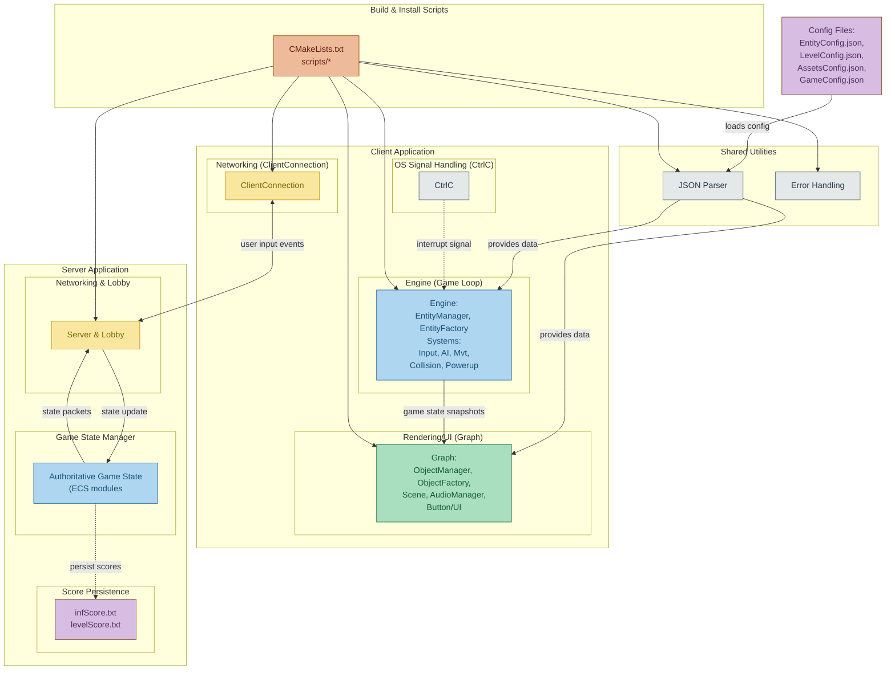

# R-Type

Latest project of the third year at EPITECH in `C++`.

---
## Availability

Our project is available for `macOS`, `Linux` and `Windows` platforms.

---
## Documentation

The documentation of the project is available in the Wiki section.

A very detailled developer documentation is available in the [Documentation/html](Documentation/html) folder **ONLY** if `doxygen` has been run before.

---
## Release

Releases of the project are actually available [here](https://github.com/EpitechPromo2026/B-CPP-500-LYN-5-2-rtype-erwann.laplante/releases).

Select your platform and download the archive, then extract it using the following command:

```bash
tar -xzf r-type-[version]-[platform].tar.gz
```

Then you can launch the server and the client using the commands from above.

## Diagram of the project


---
## License

This project is licensed under the MIT License - see the [LICENSE](LICENSE) file for more details.
